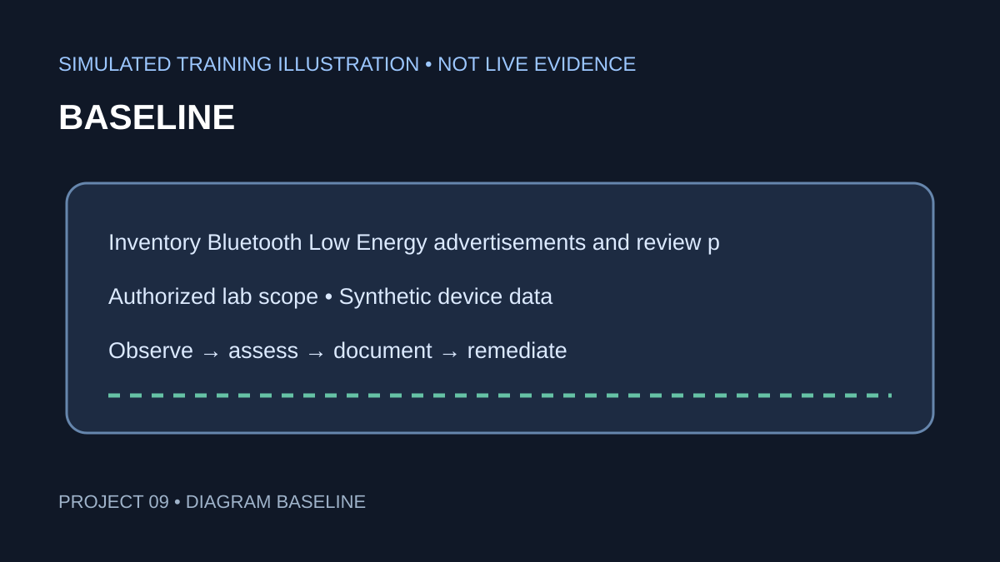
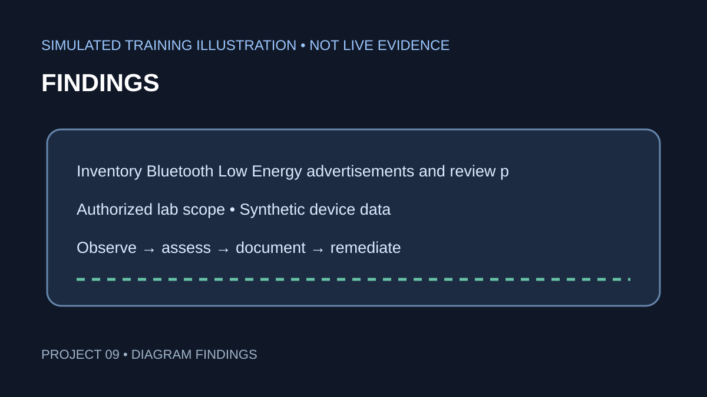
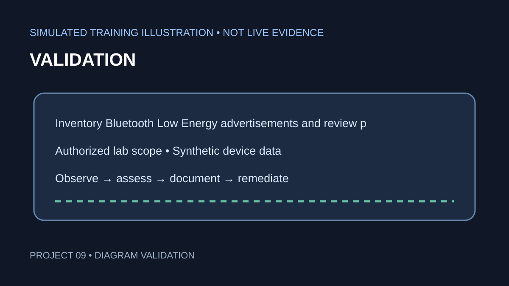

# Project 09: BLE Device Discovery and Security Baseline

## Objective
Inventory Bluetooth Low Energy advertisements and review pairing settings on owned devices.

## Scope and authorization
Perform this exercise only on devices, firmware, networks, and accounts that you own or are explicitly authorized to assess. Use an isolated lab, synthetic data, and non-destructive checks. Do not target public infrastructure, safety-critical systems, medical devices, vehicles, or third-party devices.

## Prerequisites
- Kali Linux or another analysis workstation
- An isolated virtual network and an owned device or simulator appropriate to this exercise
- Written scope, target allowlist, test window, and rollback plan
- Evidence directory and notes with timestamps

## Lab setup
1. Create or select a dedicated lab segment with no route to production networks.
2. Snapshot virtual machines and record device model, firmware, and test addresses.
3. Use synthetic accounts and data; disable any real-world integrations.
4. Confirm the target is in scope before sending test traffic.

## Assessment workflow
1. Use a BLE development board or simulator
2. capture advertisements in a controlled room
3. identify service UUIDs
4. inspect pairing mode and bonding policy
5. test only the lab device
6. recommend privacy and pairing improvements.

## Example tooling
Choose tools appropriate to the lab and keep activity constrained to the allowlist. Common defensive analysis tools include Wireshark/tshark, Nmap for low-rate discovery, Mosquitto clients for MQTT labs, BlueZ utilities for BLE labs, firmware file-identification and extraction utilities, and standard hashing tools. Review each tool's options before use; avoid destructive, high-volume, or out-of-scope operations.

## Expected observations
Record confirmed assets, protocol behavior, exposed interfaces, configuration decisions, access-control outcomes, and relevant log events. Distinguish verified findings from hypotheses and include the exact lab conditions needed to reproduce each result.

## Findings and risk
For each issue capture: title, affected asset, evidence, preconditions, impact, likelihood, severity, and business or safety relevance. Avoid publishing secrets, personal data, or exploitable details about real devices. Map applicable weaknesses to CWE and the OWASP Internet of Things Top 10 where relevant.

## Remediation
Apply least privilege, unique device identities, secure defaults, authenticated and encrypted communications, signed updates, network segmentation, minimized services, secure logging, and timely patching as appropriate to the finding.

## Validation
Repeat the same bounded test after remediation. Confirm the unwanted behavior is no longer present and that required device functions still work. Preserve before/after evidence with sensitive values redacted.

## Deliverables
- Scope and lab topology
- Asset and test-case inventory
- Sanitized packet captures or configuration excerpts
- Findings register with severity and CWE/OWASP mapping
- Remediation plan and retest results
- Short executive summary

## Training diagrams
These are simulated illustrations for learning and documentation, not screenshots or evidence from a real assessment.

