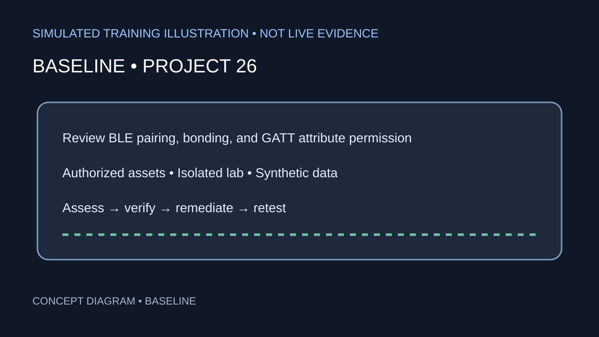
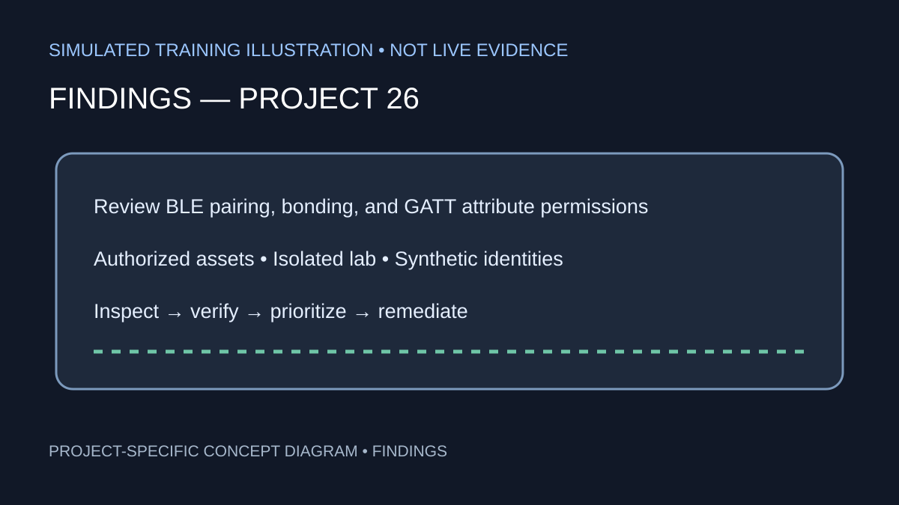
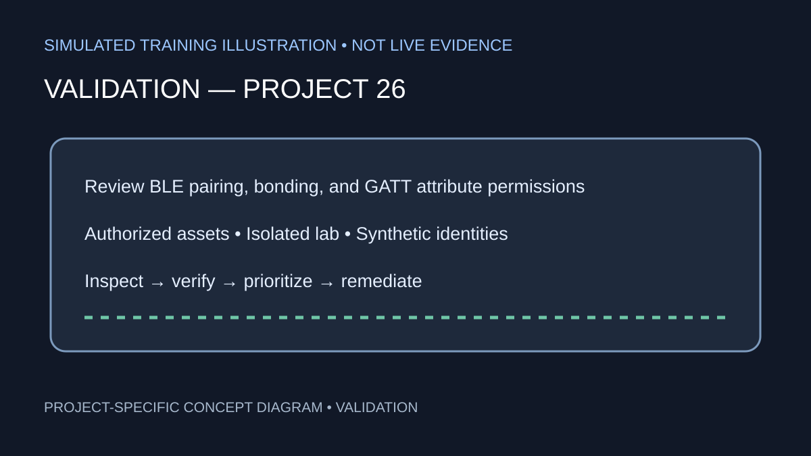

# Project 26: BLE Pairing and GATT Permissions Assessment

## Objective
Review BLE pairing, bonding, and GATT attribute permissions on a lab peripheral.

## Authorization and safety
Use only owned devices, vendor-provided samples, simulators, or systems explicitly authorized in writing. Keep testing inside an isolated lab. Do not target public services, safety-critical systems, or third-party devices. Avoid destructive writes, credential harvesting, stealth, persistence, and high-volume traffic.

## Prerequisites
- Kali Linux or equivalent analysis workstation
- Isolated lab, simulator, owned development board, or authorized firmware sample
- Written scope, target allowlist, test window, and rollback plan
- Evidence directory; redact secrets and personal data

## Lab preparation
1. Snapshot the lab and isolate it from production and public networks.
2. Record device, firmware, tool, and sample versions and provenance.
3. Use synthetic identities and test data only.
4. Verify the exact target is in scope before each test.

## Procedure
1. Use an owned peripheral or simulator
2. enumerate advertised services
3. map characteristics to intended roles
4. test read/write permissions using approved test identities
5. inspect pairing and bonding.

## Tooling guidance
Use vendor documentation and appropriate defensive tools for the artifact or protocol. Examples include Wireshark/tshark, Mosquitto utilities, BlueZ, firmware analysis tools, SBOM generators, mobile static-analysis tools, and lab API proxies. Prefer read-only and simulator modes; constrain traffic to approved lab targets.

## Expected results
A reproducible inventory of observed behavior, configuration state, component versions, access decisions, and relevant logs. Label simulated observations and distinguish verified weaknesses from hypotheses.

## Findings and risk rating
Document asset, evidence, preconditions, impact, likelihood, severity, affected versions, and confidence. Map applicable weaknesses to CWE and OWASP IoT Top 10; use CVSS where meaningful and explain assumptions.

## Remediation
Apply secure defaults, unique identities, least privilege, cryptographic integrity, authenticated encryption, minimal exposed interfaces, timely updates, and monitoring as appropriate.

## Validation
Repeat the same bounded test after remediation. Verify the control and normal device function. Preserve sanitized before/after evidence.

## Deliverables
- Scope and lab architecture
- Test procedure and tool/version notes
- Sanitized evidence and findings register
- Risk rationale and CWE/OWASP mapping
- Remediation actions and retest outcome

## Training illustrations
Simulated diagrams for learning, not live device screenshots or real assessment evidence.

