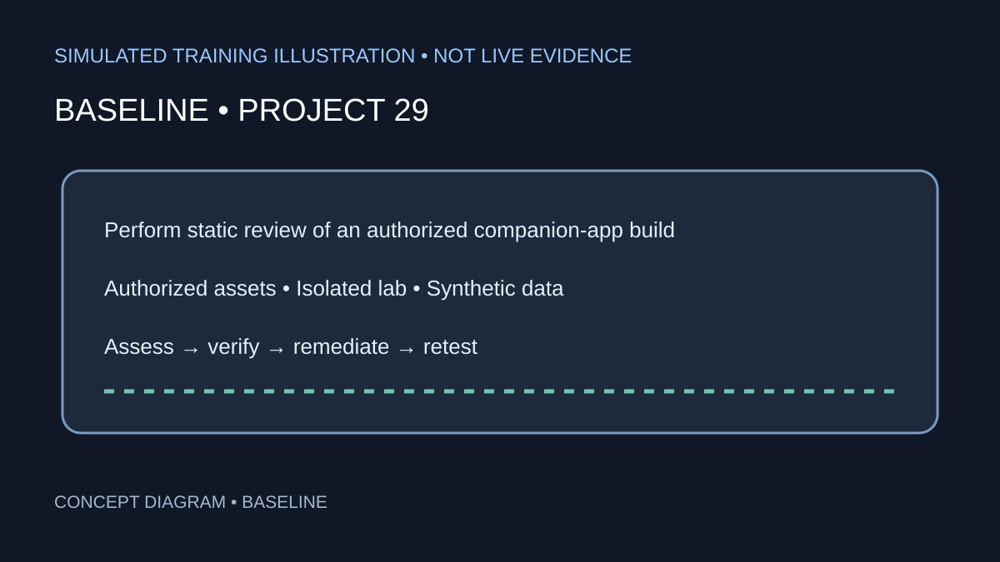
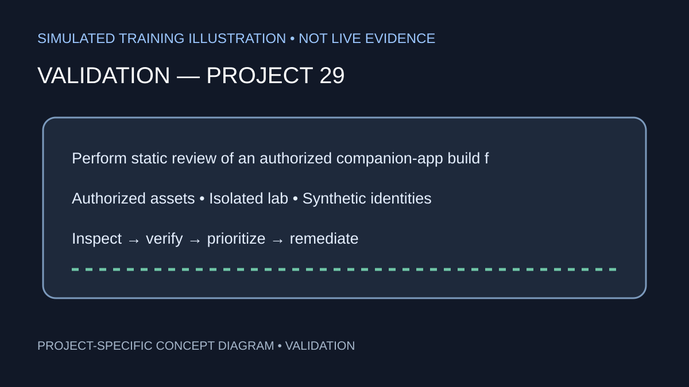

# Project 29: IoT Mobile Companion App Static Security Review

## Objective
Perform static review of an authorized companion-app build for insecure storage and configuration.

## Authorization and safety
Use only owned devices, vendor-provided samples, simulators, or systems explicitly authorized in writing. Keep testing inside an isolated lab. Do not target public services, real users, safety-critical/medical/vehicle systems, or production infrastructure. Avoid destructive writes, credential harvesting, stealth, persistence, and high-volume traffic.

## Prerequisites
- Kali Linux or equivalent analysis workstation
- Appropriate lab simulator, development board, firmware sample, or synthetic backend
- Written scope, target allowlist, test window, and rollback plan
- Evidence directory; redact secrets and personal data

## Lab preparation
1. Snapshot the lab and isolate it from production and public networks.
2. Record device, firmware, tool, and sample versions and provenance.
3. Use synthetic identities and test data only.
4. Verify the exact target is in scope before each test.

## Procedure
1. Use a test APK/IPA supplied by its owner
2. inspect permissions, exported components, embedded endpoints, logging, and local storage
3. use synthetic credentials
4. report only validated issues.

## Tools and technique
Use vendor documentation and appropriate defensive tooling for the protocol or artifact. Examples may include Wireshark/tshark, Mosquitto utilities, BlueZ, firmware identification/extraction tools, SBOM generators, mobile static-analysis tools, and lab API proxies. Select read-only or simulator modes where possible; review tool options and constrain all traffic to approved lab targets.

## Expected results
A reproducible inventory of observed behavior, configuration state, component versions, access decisions, and relevant logs. Clearly label simulated observations and distinguish verified weaknesses from hypotheses.

## Findings and risk rating
Document asset, evidence, preconditions, impact, likelihood, severity, affected versions, and business context. Map applicable weaknesses to CWE and OWASP IoT Top 10; use CVSS where meaningful and explain assumptions. Do not disclose working secrets.

## Remediation
Recommend secure defaults, unique identities, least privilege, cryptographic integrity, authenticated encryption, minimal interfaces, timely updates, monitoring, and lifecycle controls appropriate to the finding.

## Validation and evidence
Repeat the same bounded test after remediation; verify both the security control and normal device function. Keep sanitized logs, hashes, screenshots from the lab, and before/after configuration excerpts.

## Deliverables
- Scope and lab architecture
- Test procedure and tool/version notes
- Sanitized evidence and findings register
- Risk rationale and CWE/OWASP mapping
- Remediation actions and retest outcome

## Training illustrations
These are simulated diagrams, not live device screenshots or real assessment evidence.

