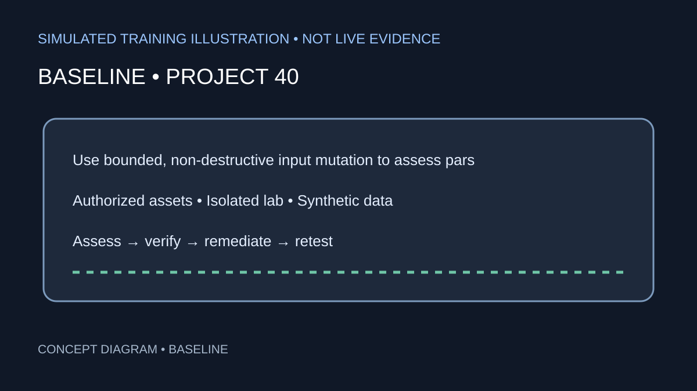
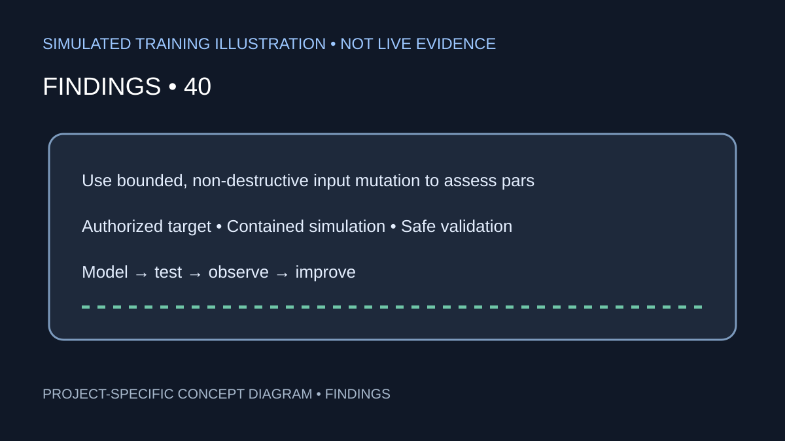
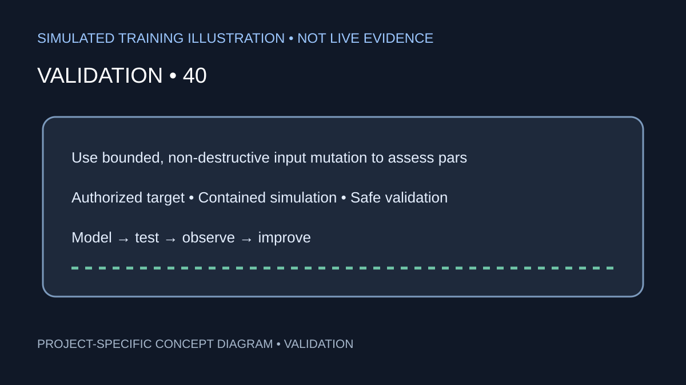

# Project 40: IoT Protocol Fuzzing in a Simulator

## Objective
Use bounded, non-destructive input mutation to assess parser robustness in a protocol simulator.

## Authorization and safety boundaries
This advanced exercise is restricted to owned devices, supplied firmware, synthetic services, or explicitly authorized isolated training environments. Industrial control, medical, automotive, public infrastructure, and other safety-critical systems must remain simulated; never test live operational technology. Do not deploy malware, persistence, botnet code, destructive firmware changes, credential theft, or denial-of-service activity.

## Prerequisites
- Isolated lab or simulator with snapshots and rollback
- Written scope, allowlisted targets, test window, and stop conditions
- Vendor documentation and known-good reference artifacts
- Evidence storage with secrets and personal data redacted

## Preparation
1. Confirm authorization and that every target is within the allowlist.
2. Record versions, hashes, network topology, and simulator configuration.
3. Use synthetic identities, messages, and telemetry.
4. Establish rate limits, safety checks, and a rollback plan.

## Procedure
1. Select a local simulator and documented message schema
2. define strict rate and size limits
3. mutate synthetic messages
4. monitor crashes and logs
5. stop on instability
6. preserve seeds and reproduce only in the isolated environment.

## Tooling guidance
Prefer vendor-supported analysis tools, static analysis, protocol analyzers, simulators, and defensive monitoring. Any active test must be bounded, non-destructive, and confined to the lab. Review tool documentation and record exact versions and relevant configuration.

## Expected results
A documented architecture or behavior model, repeatable test observations, sanitized evidence, and clearly stated limitations. For simulated exercises, label results as simulated and do not present them as findings against a real product.

## Findings and mapping
Record affected component, preconditions, evidence, impact, likelihood, severity, and confidence. Map applicable issues to CWE, OWASP IoT Top 10, and relevant NIST or IEC/ISA guidance where appropriate. State when a control could not be verified.

## Remediation
Prioritize secure boot and signed updates, hardware-backed key protection, device-specific identity, least privilege, segmentation, minimal exposed interfaces, robust input handling, privacy by design, monitoring, and supported patch lifecycles.

## Validation
Re-run the same safe test in the simulator or owned lab. Verify the control blocks the modeled weakness, normal functionality remains intact, and logs provide useful evidence. Preserve a sanitized before/after record.

## Deliverables
- Scope, assumptions, and architecture diagram
- Test cases and simulator/tool versions
- Sanitized evidence and findings register
- Risk ratings and framework mappings
- Remediation plan, retest evidence, and executive summary

## Training illustrations
The following are simulated training diagrams, not live screenshots or proof of a real-world compromise.

